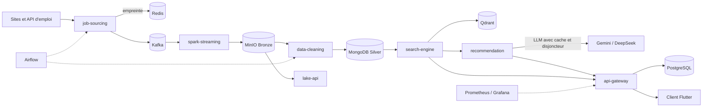

# TalentFlow

Un pipeline big data qui transforme des offres d'emploi éparpillées sur le web en une recherche sémantique et en analyses CV / offre, servies à une application Flutter.

Le difficile n'est pas de collecter une offre. C'est d'en collecter des milliers sous des formats différents, de les nettoyer sans doublons, puis de garder le tout assez frais pour qu'un candidat puisse s'y fier.

## Ce que ça apporte

- **Un flux de bout en bout, de la page web à l'écran du candidat.** Collecte (Scrapy, Adzuna, JSearch), Kafka, Spark Structured Streaming, lac MinIO, MongoDB, Qdrant, puis passerelle NestJS et client Flutter. Chaque étape est un service isolé.
- **Des données traitées pour être utilisables, pas seulement stockées.** Déduplication par empreinte dans Redis dès la collecte, couches Bronze et Silver, calcul de fraîcheur avec durée de validité par offre, pénalités pour les contenus bruités des job boards.
- **Des appels LLM qui ne bloquent pas le service.** Les analyses de CV passent par Gemini ou DeepSeek, avec cache, budget et disjoncteur par fournisseur (5 échecs ouvrent le circuit, 60 secondes avant nouvel essai par défaut, réglable par variables d'environnement).

## Le problème

Un candidat cherche « data engineer » et tombe sur la même annonce publiée sous trois titres, sur quatre sites, dont une périmée depuis des semaines. Chaque site structure ses pages à sa façon. Comparer son CV à ces offres se fait à la main.

TalentFlow règle cela en amont. Il collecte en continu, normalise dans un lac de données, retire les doublons et les offres expirées, puis indexe le texte par sens plutôt que par mots-clés. Le CV est ensuite comparé aux offres : écarts de compétences, score de matching.

## Démarrer en cinq minutes

Prérequis : Docker et Docker Compose.

```bash
cd backend
cp .env.example .env
# renseigner les valeurs CHANGEME dans .env (mots de passe, JWT_SECRET, clés LLM)
docker compose --profile lake-only up -d --build
docker compose ps
```

Ce profil démarre l'infrastructure de base, MinIO, `lake-api` (port 8004) et le tableau de bord Streamlit (port 8501). Pour ajouter la passerelle, la recommandation et la recherche, utilisez `--profile api`. Les scripts `scripts/bash/env-generator.sh` et `scripts/powershell/env-generator.ps1` génèrent les secrets. La passerelle refuse de démarrer sans `JWT_SECRET`.

## Comment ça marche



Trois choix structurent le projet.

**Un lac en deux couches.** Bronze garde la donnée brute telle que Spark l'a reçue de Kafka, avec partition et offset. Silver contient la donnée nettoyée dans MongoDB. `data-cleaning` lit Bronze dans MinIO : une règle de nettoyage modifiée s'applique à la donnée déjà collectée, sans nouvelle collecte.

**Dédupliquer à la source.** `job-sourcing` calcule une empreinte par offre et l'interroge dans Redis avant de publier sur Kafka. Les doublons n'entrent pas dans le pipeline, ce qui épargne Spark, le stockage et l'index.

**La fraîcheur comme règle de classement.** `data-cleaning` annote chaque offre (date, source de la date, durée de validité). `search-engine` filtre les offres expirées et rétrograde les anciennes. Les tests couvrent le cas d'une offre internationale de 38 jours jugée périmée avec un seuil de 21 jours.

Le scraping, lui, apprend : le module `smart_parser` mémorise par domaine les sélecteurs CSS qui ont fonctionné et réutilise les meilleurs sur les pages suivantes.

## Stack technique

| Domaine | Technologies |
|---|---|
| Passerelle | NestJS 10, TypeScript, Prisma, PostgreSQL, GraphQL (Apollo), Passport JWT, pdf-lib |
| Services de données | Python, FastAPI, Scrapy, PySpark 3.5 |
| Stockage et messagerie | Kafka, MinIO, MongoDB, Redis, Qdrant, Elasticsearch |
| IA | fastembed / sentence-transformers (`paraphrase-multilingual-MiniLM-L12-v2`), Gemini, DeepSeek, OCR (pytesseract) |
| Orchestration et supervision | Airflow, Prometheus, Grafana, cAdvisor, Streamlit |
| Client | Flutter (Dart 3.9 ou plus) |
| Déploiement | Docker Compose, manifestes Kubernetes, GitHub Actions, Nginx |

## Structure du dépôt

```
backend/
  api-gateway/       NestJS (auth, GraphQL, historique, rapports PDF)
  job-sourcing/      Scrapy, clients d'API, producteur Kafka
  spark-streaming/   Kafka vers MinIO Bronze
  data-cleaning/     Bronze vers Silver (MongoDB)
  lake-api/          API de lecture du lac
  search-engine/     Embeddings et recherche Qdrant
  recommendation/    Analyse CV/offre, LLM, classifieur de CV
  dashboard/         Tableau de bord Streamlit
  monitoring/        Prometheus, Grafana, règles d'alerte
  orchestration/     DAGs Airflow, manifestes Kubernetes
  shared/            Modules Python communs
  config/, nginx/, scripts/
  docker-compose.yml
docs/                Notes d'architecture
frontend/talentflow_flutter/   Client Flutter
.github/workflows/   Déploiement et tests de fumée
```

Pour vérifier le code, commencez par les tests :

```bash
cd backend/data-cleaning && python -m pytest tests
cd backend/search-engine && python -m pytest tests
```

Ils sont exécutables sans les services. Les tests de `recommendation`, le test de fumée de la passerelle (`npm run test:e2e:smoke`) et `flutter test` demandent leurs dépendances ou une passerelle active.

## Limites et suite

Le projet vise une démonstration d'architecture, pas un service en production. Ce périmètre est un choix.

- **Données.** Seuls de petits échantillons synthétiques sont fournis. Les données réelles viennent de la collecte et ne sont pas redistribuées.
- **Ressources.** La pile complète (Kafka, Spark, Elasticsearch, Qdrant, Airflow) est lourde. Les profils Compose permettent de n'en lancer qu'une partie.
- **LLM.** Les analyses de CV demandent des clés d'API externes.
- **Tests.** Les services de données sont testés. La passerelle n'a qu'un test de fumée et le client Flutter un seul test de widget. Étendre cette couverture est la suite la plus utile.
- **Déploiement.** Les workflows GitHub Actions supposent un hôte distant configuré par secrets (`OCI_HOST`, `OCI_USER`, `OCI_SSH_KEY`). Les noms de domaine sont remplacés par `example.com`.
- **Documentation.** Certaines notes de `docs/` datent du développement et peuvent différer du code. En cas d'écart, le code fait foi.

Le client Flutter se lance avec `flutter run -d chrome --dart-define-from-file=env/web.local.json.example` depuis `frontend/talentflow_flutter`.

## Licence et contact

Licence : tous droits réservés. La lecture du code à des fins d'évaluation est permise. Voir le fichier `LICENSE`.

Jean-Paul ADOGLI, étudiant ingénieur en data science et big data. GitHub : [Jean-Paul15](https://github.com/Jean-Paul15).
