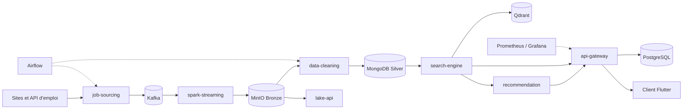

# TalentFlow

Plateforme de recrutement et de matching offres/CV, bâtie sur une architecture big data en microservices : collecte d'offres, nettoyage, indexation sémantique, recommandation et application mobile/web.

## Problème résolu

Les offres d'emploi sont dispersées sur de nombreux sites aux formats hétérogènes, et les candidats comparent difficilement leur CV à ces offres. TalentFlow collecte les offres en continu, les normalise dans un lac de données (couches Bronze puis Silver), les indexe pour une recherche sémantique et analyse l'adéquation entre un CV et une offre.

## Fonctionnalités

- Collecte d'offres par spiders Scrapy et clients d'API (Adzuna, JSearch), avec déduplication par empreinte dans Redis et publication sur Kafka (`job-sourcing`).
- Ingestion en continu Kafka vers MinIO (couche Bronze) via Spark Structured Streaming (`spark-streaming`).
- Nettoyage, déduplication et enrichissement Bronze vers MongoDB (couche Silver) (`data-cleaning`).
- Consultation de la couche Bronze par une API FastAPI (`lake-api`).
- Recherche sémantique : embeddings multilingues (`paraphrase-multilingual-MiniLM-L12-v2`) indexés dans Qdrant, filtres de qualité et de fraîcheur (`search-engine`).
- Recommandation : analyse CV / offre (écarts de compétences, score de matching), classification de documents CV, appel à des LLM (Gemini, DeepSeek) avec cache et disjoncteur (`recommendation`).
- Passerelle NestJS : authentification JWT, GraphQL et REST, favoris, historique, tâches d'analyse de CV, export PDF de rapports (`api-gateway`).
- Orchestration Airflow, supervision Prometheus / Grafana, tableau de bord Streamlit (`dashboard`).
- Client Flutter (Android et web) (`frontend/talentflow_flutter`).

## Architecture



## Stack technique

| Domaine | Technologies |
|---|---|
| Passerelle | NestJS 10, TypeScript, Prisma, PostgreSQL, GraphQL (Apollo), Passport JWT, pdf-lib |
| Services de données | Python, FastAPI, Scrapy, PySpark 3.5 |
| Stockage et messagerie | Kafka, MinIO, MongoDB, Redis, Qdrant, Elasticsearch |
| IA | fastembed / sentence-transformers, Gemini, DeepSeek, OCR (pytesseract) |
| Orchestration et supervision | Airflow, Prometheus, Grafana, cAdvisor, Streamlit |
| Client | Flutter (Dart ≥ 3.9) |
| Déploiement | Docker Compose, manifestes Kubernetes, GitHub Actions, Nginx |

## Installation

Prérequis : Docker et Docker Compose, Python 3.11, Node.js 18+ (développement de la passerelle), Flutter (client).

```bash
git clone <url-du-depot>
cd talentflow/backend
cp .env.example .env
```

Renseigner dans `.env` les valeurs marquées `CHANGEME` (mots de passe, `JWT_SECRET`, clés LLM). La passerelle refuse de démarrer sans `JWT_SECRET`. Les scripts `scripts/bash/env-generator.sh` et `scripts/powershell/env-generator.ps1` peuvent générer ces secrets.

## Usage

Les services sont regroupés par profils Docker Compose (`lake-only`, `sourcing-only`, `sourcing`, `api`, `monitoring`, `orchestration`, `demo-bigdata`, `all`).

```bash
cd backend
docker compose --profile lake-only up -d --build
docker compose --profile api up -d --build
docker compose ps
```

Ports exposés en local uniquement (127.0.0.1) : passerelle 3000, job-sourcing 8000, recommendation 8001, data-cleaning 8002, search-engine 8003, lake-api 8004, dashboard Streamlit 8501, Grafana 3001, Airflow 8080. Un utilitaire `manage.sh` (ou `manage.ps1`) regroupe les opérations courantes.

Client Flutter :

```bash
cd frontend/talentflow_flutter
flutter pub get
flutter run -d chrome --dart-define-from-file=env/web.local.json.example
```

Passerelle seule, en développement :

```bash
cd backend/api-gateway
npm install
npx prisma generate
npm run start:dev
```

## Structure du dépôt

```
backend/
  api-gateway/       NestJS (auth, GraphQL, historique, rapports PDF)
  job-sourcing/      Scrapy, clients d'API, producteur Kafka
  spark-streaming/   Kafka vers MinIO Bronze
  data-cleaning/     Bronze vers Silver (MongoDB)
  lake-api/          API de lecture du lac
  search-engine/     Embeddings et recherche Qdrant
  recommendation/    Analyse CV/offre, LLM, classifieur de CV
  dashboard/         Tableau de bord Streamlit
  monitoring/        Prometheus, Grafana, règles d'alerte
  orchestration/     DAGs Airflow, manifestes Kubernetes
  shared/            Modules Python communs
  config/, nginx/, scripts/
  docker-compose.yml
docs/                Notes d'architecture techniques
frontend/talentflow_flutter/   Client Flutter
.github/workflows/   Déploiement et tests de fumée
```

## Tests

```bash
cd backend/data-cleaning && python -m pytest tests
cd backend/search-engine && python -m pytest tests
cd backend/recommendation && python -m pytest tests
cd backend/api-gateway && npm run test:e2e:smoke   # nécessite SMOKE_TEST_PASSWORD et une passerelle active
cd frontend/talentflow_flutter && flutter test
```

Les suites Python de `data-cleaning` et `search-engine` ont été exécutées à la préparation du dépôt ; les autres tests nécessitent leurs dépendances ou services.

## Limites connues

- Aucun jeu de données n'est fourni hormis de petits échantillons synthétiques ; les données réelles proviennent de la collecte et ne sont pas redistribuées.
- La couverture de tests est partielle : pas de tests unitaires côté passerelle, un seul test de widget côté Flutter.
- Les scripts de déploiement et workflows GitHub Actions supposent un hôte distant configuré via des secrets (`OCI_HOST`, `OCI_USER`, `OCI_SSH_KEY`) ; les noms de domaine sont remplacés par `example.com`.
- La pile complète est lourde (Kafka, Spark, Elasticsearch, Qdrant, Airflow) et demande des ressources importantes.
- Les fonctions LLM nécessitent des clés d'API externes.
- Certains documents de `docs/` et README de services sont rédigés pendant le développement et peuvent diverger du code.

## Licence

Licence : tous droits réservés. Voir le fichier `LICENSE`.

## Contact

Jean-Paul ADOGLI, étudiant ingénieur en data science et big data, GitHub : [Jean-Paul15](https://github.com/Jean-Paul15).
