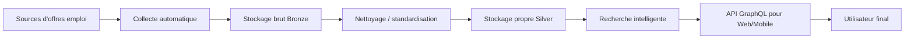

# Architecture Big Data Backend - TalentFlow (version simple pour non technique)

## Résumé en 30 secondes

TalentFlow est une usine automatisée de données emploi:

1. Le système **récupère** des offres depuis plusieurs sites.
2. Il **stocke** d'abord les données brutes.
3. Il **nettoie** et **corrige** les données.
4. Il les rend **recherchables intelligemment** (mots-clés + sens).
5. Il expose une API pour le front et donne des **recommandations CV -> offres**.

---

## Vue très simple (comme une chaîne logistique)

Idée clé:
- **Bronze** = données brutes (non fiabilisées).
- **Silver** = données propres, harmonisées, prêtes pour la recherche.

---

## Qui fait quoi (sans jargon)

| Bloc | Rôle métier |
|---|---|
| `job-sourcing` | Va chercher les offres sur les sites. |
| `Kafka` | Fait circuler les nouvelles offres entre services. |
| `spark-streaming` | Déverse en continu les offres dans le stockage brut. |
| `MinIO (Bronze)` | Archive les données telles qu'elles arrivent. |
| `data-cleaning` | Corrige, déduplique, structure les offres. |
| `MongoDB (Silver)` | Conserve les offres propres. |
| `search-engine` | Permet de retrouver les offres de façon pertinente. |
| `Qdrant` | Moteur de recherche par sens (vecteurs). |
| `Elasticsearch` | Moteur lexical/support historique (voir glossaire). |
| `recommendation` | Compare un CV texte aux offres et propose les meilleures. |
| `api-gateway` | Porte d’entrée unique pour le front (GraphQL). |
| `PostgreSQL` | Données applicatives (compte utilisateur, profil, historique). |
| `Airflow` | Planifie automatiquement les tâches récurrentes. |
| `Streamlit` | Dashboard de suivi (qualité, pipeline, recherche). |
| `Prometheus + Grafana` | Supervision technique (santé des services). |

---

## Ce qui se passe automatiquement

Quand la plateforme tourne:

1. Les DAG Airflow déclenchent les tâches selon un calendrier.
2. Le scraping alimente le pipeline.
3. Les données sont nettoyées puis indexées.
4. Le moteur de recherche est mis à jour.
5. Les alertes QA peuvent remonter si la qualité baisse.

### Fréquences principales actuellement configurées

- Pipeline global: toutes les 4 heures (`talentflow_pipeline`).
- Maintenance index recherche: toutes les heures (`search_index_maintenance_hourly`).
- QA sourcing: toutes les heures (`sourcing_qa_alerts_hourly`).
- Cleaning dédié: toutes les 6 heures (`etape2_cleaning_enrichment`).
- Rebuild index complet: 1 fois/semaine (`search_index_full_rebuild_weekly`).

Important:
- Oui, **Airflow s’exécute automatiquement** si le service Airflow est lancé.
- Si Airflow est arrêté, rien ne part “tout seul”.

---

## Réponse à la question: “Airflow se lance automatiquement ?”

Oui, si tu démarres le profil qui contient Airflow:

- `docker compose --profile sourcing up -d`
- ou `docker compose --profile orchestration up -d`
- ou `docker compose --profile all up -d`

Dans ce projet, le conteneur Airflow lance le scheduler + webserver au démarrage.
Donc les DAG programmés s’exécutent sans intervention manuelle.

---

## Réponse à la question: “compatibilité/legacy, ça veut dire quoi ?”

Dans ce contexte:

- **compatibilité** = garder un composant pour que l’ancien fonctionnement continue.
- **legacy** = ancien mode/ancien composant conservé pendant la transition.

Exemple ici:
- Le moteur principal actuel est Qdrant.
- Elasticsearch reste disponible pour compatibilité (anciens flux, tests, fallback, comparaison), même s’il n’est plus le cœur de la recherche.

---

## Pourquoi cette architecture est bonne pour un projet Big Data

1. **Scalable**: chaque bloc peut grandir séparément.
2. **Résiliente**: une panne locale ne casse pas tout le système.
3. **Traçable**: on garde le brut (Bronze) et le propre (Silver).
4. **Automatisée**: Airflow orchestre les tâches sans action manuelle.
5. **Orientée produit**: le front ne voit qu’une API simple, pas la complexité interne.

---

## Ce que voit l’utilisateur final

L’utilisateur final voit seulement:

1. Connexion / profil.
2. Recherche d’offres.
3. Recommandation à partir de son CV.
4. Liens directs pour postuler.

Toute la complexité Big Data est “derrière” cette expérience simple.

---

## Limites actuelles (honnêtes)

1. La qualité finale dépend encore de la qualité des sites source.
2. Les quotas LLM peuvent limiter certaines réponses IA.
3. Certains healthchecks Docker peuvent être plus stricts que nécessaire.

---

## Message de conclusion pour le professeur

TalentFlow est une architecture Big Data complète et réaliste:

- ingestion multi-sources,
- pipeline Bronze/Silver,
- recherche hybride moderne,
- recommandation IA,
- orchestration automatique,
- monitoring opérationnel.

Le système est conçu pour être exploitable en production tout en restant pédagogique.
