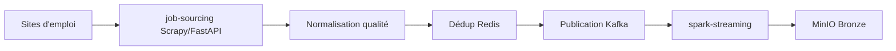

# Sourcing TalentFlow -> stockage MinIO (Bronze)

## 1) Objectif de ce document

Ce document explique uniquement la partie **collecte des offres** et leur **stockage brut dans MinIO**.
Le but est de montrer :

1. comment les offres sont capturées,
2. comment on évite les doublons,
3. comment elles arrivent dans MinIO Bronze,
4. pourquoi MinIO a été choisi.

---

## 2) Vision simple du flux



Idée clé :
- `job-sourcing` collecte.
- `Kafka` transporte les événements.
- `spark-streaming` écrit les objets JSON en Bronze.

---

## 3) Étapes détaillées

## 3.1 Collecte site par site

Le service `job-sourcing` exécute des spiders Scrapy (un dossier par site).
Chaque item contient les champs essentiels : titre, entreprise, localisation, description, URL source, etc.

Dans le pipeline Scrapy :

1. `DataQualityNormalizationPipeline`
2. `FingerprintPipeline`
3. `KafkaPipeline`

---

## 3.2 Normalisation qualité

Avant publication, une normalisation est appliquée (`normalize_job_record`) :

- harmonisation des dates (`posted_date_iso`, `deadline_iso`),
- extraction des canaux de candidature (`apply_url`, `apply_email`, `apply_phone`),
- estimation de qualité de description,
- marquage des offres probablement non valides (article, formation, etc.).

Si `SCRAPY_DROP_NON_JOB_ITEMS=true`, les non-offres probables sont rejetées.

---

## 3.3 Déduplication (anti-doublons)

Deux niveaux de dédup sont utilisés :

1. **fingerprint exact** (hash stable du contenu principal),
2. **fingerprint sémantique** (quand activé) pour détecter des offres très proches.

Le stockage des fingerprints se fait dans Redis.
Si une offre existe déjà, elle est ignorée avant Kafka.

---

## 3.4 Publication dans Kafka

Les offres non-doublons sont publiées sur le topic `talentflow_jobs_raw`.
Chaque message transporte notamment :

- les données de l'offre,
- un `hash`/fingerprint,
- la source,
- un horodatage de scraping.

Kafka découple la collecte du stockage :
- le scrape peut continuer même si l'étape suivante ralentit,
- les consommateurs peuvent rejouer le flux.

---

## 3.5 Écriture Bronze dans MinIO via Spark

`spark-streaming` consomme Kafka et écrit un objet JSON par offre dans MinIO.

Clé objet :

```text
{site}/{date_scrape}/{hash}.json
```

Exemple :

```text
emploi_tg/2026-03-02/8f2b...c91.json
```

Ce format facilite :

1. la partition naturelle par source/date,
2. la relecture sélective,
3. la traçabilité complète.

---

## 4) Pourquoi MinIO pour Bronze

MinIO est choisi pour la zone Bronze pour 6 raisons pratiques :

1. **S3-compatible** : migration facile vers AWS/GCP si besoin.
2. **Économique** : parfait pour stockage brut volumineux.
3. **Simple en local/serveur** : même API, même logique.
4. **Historique conservable** : utile pour audit et replay.
5. **Mode objet** : adapté aux événements JSON unitaires.
6. **Découplage fort** : la suite du pipeline lit Bronze sans dépendre du scraper.

En Big Data, Bronze doit rester proche de la réalité source, donc peu transformé.
MinIO convient très bien à cette philosophie.

---

## 5) Pourquoi ne pas écrire directement en base finale

Écrire directement dans une base "finale" (ex : Mongo Silver) est risqué :

1. perte d'historique brut,
2. replay compliqué en cas de bug de cleaning,
3. audit plus difficile,
4. couplage fort scraping <-> schéma final.

Le passage par Bronze MinIO rend le pipeline plus robuste.

---

## 6) Orchestration automatique (Airflow)

Airflow déclenche les jobs de sourcing selon un calendrier (DAGs).
Concrètement :

1. il lance le scraping (ou autopilot),
2. contrôle l'avancement ingestion,
3. enchaîne les étapes suivantes du pipeline.

Si Airflow est démarré, le cycle tourne automatiquement sans intervention manuelle.

---

## 7) Points de contrôle recommandés

Pour valider que le sourcing vers MinIO fonctionne bien :

1. vérifier `job-sourcing /api/stats` (items publiés),
2. vérifier lag/topic Kafka,
3. vérifier nombre d'objets MinIO Bronze,
4. vérifier répartition par site et date,
5. vérifier taux de rejet qualité et taux de doublons.

---

## 8) Limites actuelles

1. la qualité dépend encore des structures HTML des sites source,
2. certains sites changent souvent leur DOM,
3. sans gouvernance des schedules, on peut sur-scraper des sources peu actives.

---

## 9) Glossaire

- **Scrapy** : framework Python de web scraping.
- **Spider** : robot spécialisé pour un site.
- **Pipeline Scrapy** : chaîne de traitement d'un item scrapé.
- **Fingerprint** : empreinte unique d'une offre pour dédup.
- **Kafka Topic** : canal de messages d'événements.
- **Streaming** : traitement des données en continu.
- **Bronze** : donnée brute, peu ou pas transformée.
- **MinIO** : stockage objet compatible S3.
- **Replay** : rejouer un flux historique pour retraitement.
- **Découplage** : séparer les composants pour éviter les dépendances fortes.
